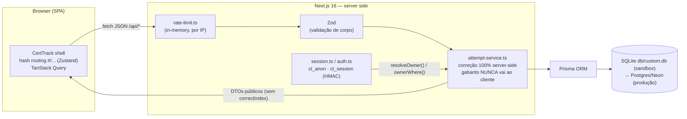
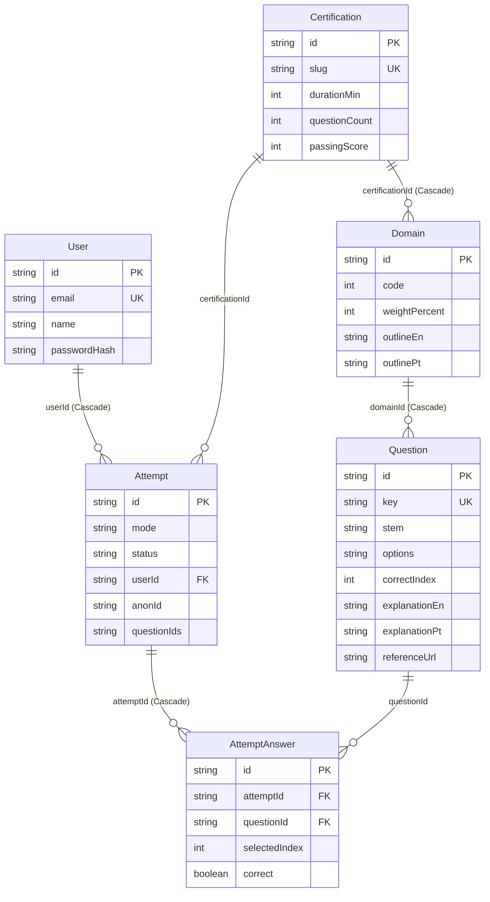

# Ranvier (by Noos) — Software Design Document (SDD)

**Versão:** 1.1.0 · **Data:** 2026-10-23 · **Status:** Documento vivo (complementar ao `worklog.md`)
**App:** Ranvier — estudos e simulados gratuitos para certificações · **Ecossistema:** Noos (assinatura "by Noos"; hub: noos.study, fallback https://noos-hub.vercel.app)
**Autor do produto:** Ironides Junior — <https://github.com/ironidesflj> · <https://www.linkedin.com/in/ironjunior/>
**Princípio norteador:** *nada se perda* — este documento existe para que futuros mantenedores tenham 100% do contexto de projeto, decisão e limitação sem precisar arqueologia no código.

> **Convenção:** texto em PT-BR; identificadores, código, comandos e termos técnicos em English onde natural.
> **Segredos:** este documento referencia apenas **nomes** de variáveis de ambiente (`DATABASE_URL`, `SESSION_SECRET`). Valores secretos jamais são impressos.

---

## 1. Visão geral do produto

**O que é.** Ranvier (codinome interno histórico "CertTrack") é um **aplicativo web gratuito de estudos e simulados para certificações** do ecossistema Microsoft/Azure & Databricks, integrado ao **ecossistema Noos** (Fase 1 — seção 16). A primeira (e, no lançamento, única) certificação suportada é a **Databricks Certified Data Engineer Associate**. A arquitetura é multi-certificação desde o dia 1 (tudo é chaveado por `slug`), mas apenas uma certificação tem conteúdo no lançamento (decisão de kickoff nº 8).

**Para quem.** Candidatos a certificação que querem: (a) diagnosticar o nível com um simulado fiel ao formato real do exame; (b) estudar por domínio com feedback imediato, explicações e referência oficial por questão; (c) acompanhar progresso por domínio e revisar erros.

**Modelo do produto:**

- **Gratuito** — sem paywall, sem cadastro obrigatório para começar (modo anônimo com progresso no servidor).
- **Independente / não-afiliado** — o Ranvier **não é afiliado, patrocinado ou endossado** por Databricks, Microsoft ou Pearson VUE. Disclaimer presente em todas as páginas (badge "Não afiliado" no rodapé, disclaimer no footer, na Home e na página Sobre). Marcas citadas apenas referencialmente.
- **Anti-dump** — zero questões de prova real reproduzidas. Questões 100% autorais (estilo cenário), cada uma com `referenceUrl` da documentação oficial que fundamenta a resposta (detalhes na seção 8).
- **Login opcional** — e-mail/senha para sincronizar progresso entre dispositivos, com merge automático do progresso anônimo.

**Funcionalidades do MVP (todas entregues na v1.0.0):**

| Funcionalidade | Descrição |
|---|---|
| Simulado (EXAM) | 45 questões, 90 min, distribuição por domínio espelhando os pesos oficiais, timer, paleta de navegação, auto-entrega no tempo (cliente **e** servidor), revisão pós-exame com explicações e links oficiais |
| Modo estudo (STUDY) | Sessões configuráveis (domínios + quantidade), feedback imediato por questão (correto/incorreto + explicação bilíngue + link oficial) |
| Progresso | Estatísticas gerais, radar S1–S7 (Recharts), barras por domínio, fila de revisão de erros (até 50 questões), histórico de tentativas com Revisar/Retomar |
| Guia de estudos | Guia bilíngue por domínio com pontos de estudo e links oficiais (`src/data/guide.ts`) |
| Página da certificação | Fatos oficiais do exame, cobertura do banco, outline por domínio |
| Sobre & Fontes | Metodologia, fontes oficiais, autor, contato, ecossistema Noos, licenças |
| Auth opcional | Registro/login/logout, merge de progresso anônimo, exclusão de conta com cascata |
| i18n | PT-BR / English (interface e conteúdo; questões sempre em EN) |
| Tema | Dark mode por padrão, toggle claro/escuro |

**Autor:** Ironides Junior (GitHub: `ironidesflj`, LinkedIn: `ironjunior`) — founder e mantenedor, creditado na página Sobre, footer e metadados do site.

**Licenças:** código **MIT** (`LICENSE`); banco de questões/conteúdo **CC BY-SA 4.0** (`LICENSE-CONTENT.md`) — decisão do ecossistema Noos (Carta/Guia de Adaptação), exibida na página Sobre e no rodapé.

---

## 2. Fatos oficiais do exame (fonte da verdade)

Todos os fatos abaixo foram capturados na sessão de pesquisa oficial (Task 0, ver `worklog.md`) a partir **das duas fontes oficiais** e são a fonte da verdade do produto — nada de "achismo de comunidade" sem rótulo:

1. **Página oficial do exame:** <https://www.databricks.com/learn/certification/data-engineer-associate>
2. **Exam Guide oficial (PDF, versão vigente "as of May 4, 2026"):** <https://www.databricks.com/sites/default/files/2026-05/databricks-certified-data-engineer-associate-exam-guide-may-2026-000.pdf>

| Fato | Valor oficial |
|---|---|
| Questões pontuadas | **45** de múltipla escolha |
| Itens não pontuados | **Podem existir e não são identificados** (o exame real pode conter mais itens do que os 45 pontuados) |
| Limite de tempo | **90 minutos** |
| Taxa | **USD 200** (+ impostos locais) |
| Entrega | Online proctored ou test center — entrega **Pearson VUE**; nenhum acessório de teste permitido |
| Pré-requisito | Nenhum obrigatório; treinamento + ~6 meses de experiência hands-on **altamente recomendados** |
| Validade | **2 anos**, com recertificação a cada 2 anos |
| Idiomas do exame real | **English, 日本語, Português (BR), 한국어** — o exame real **oferece PT-BR** (o app mantém questões em EN por decisão do cliente — ver seção 10) |
| Código | Manipulação de dados em **SQL quando possível; nos demais casos, Python** (o banco de questões respeita isso: SQL dominante, PySpark onde natural) |
| Nota de corte | **Não publicada oficialmente** pela Databricks → o app usa **70% como referência comunitária, rotulada com honestidade** (`passingScoreIsOfficial: false`; UI mostra "Corte comunitário — a Databricks não publica a nota oficial") |
| Versão do exame | **May 4, 2026** (`versionLabel: "Exam version: May 4, 2026"`) |

**Domínios oficiais (7 seções) e pesos — versão May/2026:**

| Seção | Domínio | Peso | Banco (questões) | Simulado (45) |
|---|---|---|---|---|
| S1 | Databricks Intelligence Platform | **6%** | 8 | 3 |
| S2 | Data Ingestion and Loading | **21%** | 24 | 9 |
| S3 | Data Transformation and Modeling | **22%** | 25 | 10 |
| S4 | Working with Lakeflow Jobs | **16%** | 18 | 7 |
| S5 | Implementing CI/CD | **10%** | 12 | 5 |
| S6 | Troubleshooting, Monitoring, and Optimization | **10%** | 12 | 4 |
| S7 | Governance and Security | **15%** | 17 | 7 |
| — | **Total** | **100%** | **116** | **45** |

A coluna "Simulado" é a distribuição oficial espelhada (método do maior resto sobre os pesos: 3/9/10/7/5/4/7 = 45), codificada em `EXAM_DISTRIBUTION` (`src/data/certifications.ts`) e **recomputada em runtime** pelo `stratifiedCounts()` (`src/lib/attempt-service.ts`) — ou seja, a distribuição do simulado não depende de uma tabela fixa no banco, e sim dos pesos oficiais persistidos por domínio.

**Onde isso vive no código:** `src/data/certifications.ts` (metadados + outline oficial EN/PT por domínio, bilíngue integral) → persistido no banco pelo seed (`scripts/seed.ts`) → servido ao cliente por `GET /api/catalog`.

---

## 3. Equipe e governança

O cliente definiu **10 papéis** no kickoff. Mapeamento de participação (conforme `worklog.md` — Tasks 0, 1-a..1-e, 6, 7):

| Papel | Quem / Como participou |
|---|---|
| **SaaS Transformation Lead** | Orquestrador principal (Task 0): kickoff com o cliente (9 decisões + extras), pesquisa oficial do exame via agent-browser, priorização e coordenação das entregas |
| **Product Architect** | Orquestrador (Task 0): decisão arquitetural (Next.js single-page, APIs REST, Prisma portável, auth leve, correção server-side, i18n próprio, ads config-gated); desenho do blueprint multi-certificação |
| **Database Architect** | Validação do orquestrador: `prisma/schema.prisma` (6 modelos, cascatas), seed idempotente por `key`, portabilidade SQLite→Postgres, índices de consulta por dono |
| **Security Engineer** | Validação do orquestrador: correção 100% server-side, isolamento por tentativa (404 para não-donos), scrypt + HMAC, cookies httpOnly, Zod em todos os corpos, rate limit, headers de segurança, imposição do timer no servidor, threat model (seção 7) |
| **Backend Lead** | Validação do orquestrador: `src/lib/attempt-service.ts` (amostragem estratificada, grading, auto-submit), rotas `/api/*`, `api-helpers.ts` |
| **Frontend Lead** | Validação do orquestrador: shell single-page (`certtrack-app.tsx`), hash routing (`store/app-store.ts`), wiring TanStack Query nas 8 views |
| **UX Researcher** | Validação do orquestrador: toggle de idioma, dark mode padrão, a11y (aria, foco, contraste), mobile-first verificado em 390×844; extras aprovados no kickoff (radar de progresso, fila de revisão de erros, página Sobre/Fontes) |
| **Technical Writer** | Subagente (Task 7 — este SDD); padrão bilíngue das explicações; conteúdo do guia de estudos bilíngue (`src/data/guide.ts`, "Technical Writer content") |
| **QA Lead** | Orquestrador + agent-browser (Task 6): E2E completo desktop 1280×800 e mobile 390×844, golden path ponta a ponta, teste adversarial do timer, 3 bugs encontrados e corrigidos |
| **Red Team Reviewer** | Subagente adversarial (Task 8): **gate final de entrega**. Requisitos incorporados durante a implementação (ex.: cascatas para evitar dados órfãos — comentário explícito no schema: "Cascade deletes prevent orphan data (Red Team requirement)"; 404 para não-donos). O QA (Task 6) declarou o app pronto para o Red Team Review; a revisão adversarial final é o último passo antes de entrega pública |

**Redação do banco de questões:** 5 subagentes paralelos (Tasks 1-a..1-e), um por grupo de seções, cada um com verificação factual contra a documentação oficial viva (curl) antes de escrever.

**Regra de governança (decisão do cliente):** **nenhuma entrega sem sobreviver ao Red Team.** O Red Team revisa adversarialmente (segurança, conformidade IP, qualidade de conteúdo) e só depois a versão é considerada entregue.

---

## 4. Arquitetura

### 4.1 Stack

| Camada | Tecnologia |
|---|---|
| Framework | **Next.js 16** (App Router; `next ^16.1.1`) — **single-page**: única rota física `/` (`src/app/page.tsx`), navegação interna por **hash routing** `#/...` |
| Linguagem | **TypeScript** (strict nos módulos do app) |
| UI | **Tailwind CSS 4** + **shadcn/ui** (Radix UI) + `lucide-react`; dark mode padrão via `next-themes` |
| Estado cliente | **Zustand** (`src/store/app-store.ts` — view/attemptId/hash) + **TanStack Query 5** (server-state; `staleTime: 60s`, `retry: 1`, `refetchOnWindowFocus: false`) |
| Gráficos | **Recharts** (radar de progresso por domínio em `progress-view.tsx`) |
| Markdown | `react-markdown` (subset seguro: parágrafos, fenced code, inline code, bold, links; **sem HTML cru** — `src/components/app/markdown.tsx`) |
| Backend | API Routes do Next.js em `/api/*` (JSON); serviço central `src/lib/attempt-service.ts` |
| ORM/DB | **Prisma 6** + **SQLite** no sandbox dev (`db/custom.db` via `DATABASE_URL`); schema **portável a Postgres/Neon** para produção |
| Auth | Própria e leve (`src/lib/auth.ts`): scrypt + token HMAC — ver 4.4 |
| Validação | **Zod 4** em todos os corpos de request |

> Nota honesta de scaffold: `next.config.ts` mantém `typescript.ignoreBuildErrors: true` e `reactStrictMode: false` (padrões do sandbox). O código passa limpo no ESLint (`bun run lint` — 0 erros no QA), mas recomenda-se remover `ignoreBuildErrors` ao trazer para produção para falhar builds em erro de tipo.

### 4.2 Diagrama de fluxo



### 4.3 Correção 100% server-side (invariante central)

**O gabarito (`Question.correctIndex`) nunca vai ao cliente antes de o usuário responder (STUDY) ou de a tentativa estar COMPLETED (EXAM).** Implementação:

- DTO público de questão (`PublicQuestion` em `src/lib/types.ts`) **não tem** campo de resposta — comentário no arquivo: *"Never include correctIndex in public question DTOs"*.
- `toPublicQuestion()` (`attempt-service.ts`) projeta apenas id/domínio/dificuldade/stem/options.
- `answerQuestion()`: em EXAM retorna `{ stored: true }` (nada de gabarito); em STUDY retorna o feedback (correto, `correctIndex`, explicações, referência) **apenas da questão respondida**.
- `getAttemptDetail()`: só inclui `correctIndex`/explicações quando `status === "COMPLETED"` (revisão).

### 4.4 Identidade: sessão anônima + login opcional com merge

Dois modos (`src/lib/session.ts`):

1. **Anônimo (padrão):** cookie `ct_anon` — UUID aleatório, `httpOnly`, `sameSite: lax`, `secure` em produção, 365 dias. Criado no primeiro contato (`resolveOwner()`). Todas as tentativas anônimas são gravadas no servidor com `anonId`.
2. **Logado (opcional):** cookie `ct_session` — token stateless `${userId}.${expiry}.${hmac-sha256}` assinado com `SESSION_SECRET`, TTL 30 dias, `httpOnly`/`sameSite: lax`/`secure`-em-prod. Verificação com `timingSafeEqual` + checagem de expiração.

**Merge:** em login/registro, `mergeAnonAttemptsIntoUser()` faz `updateMany` das tentativas `anonId = cookie, userId = null` → `userId = user, anonId = null`. Resultado: progresso anônimo sincroniza instantaneamente na conta ("sync" no primeiro login, zero dados órfãos). A resposta da API informa `mergedAttempts` (contagem) e a UI mostra toast de sincronização.

**Propriedade (ownership):** `ownerWhere()` devolve `{ userId }` (logado) ou `{ anonId, userId: null }` (anônimo). Toda leitura/escrita de tentativa filtra por essa condição (`getOwnedAttempt()` → 404 se não pertencer ao dono atual).

### 4.5 Hash routing

`src/store/app-store.ts` mapeia o `window.location.hash` para views internas (sem recarregar a página):

| Hash | View | Observação |
|---|---|---|
| `#/` | home | |
| `#/certificacao` (alias `#/certification`) | cert | |
| `#/estudar` (alias `#/study`) | study | |
| `#/simulado/:attemptId` (alias `#/exam/...`) | exam | requer id; sem id → home |
| `#/resultado/:attemptId` (alias `#/results/...`) | results | requer id |
| `#/progresso` (alias `#/progress`) | progress | |
| `#/guia` (alias `#/study-guide`) | guide | |
| `#/sobre` (alias `#/about`) | about | |

`navigate()` escreve o hash, atualiza o estado e rola para o topo; `syncFromHash()` + evento `hashchange` mantêm o estado sincronizado (retomada por URL funciona: colar `#/simulado/<id>` restaura a tentativa). A view `exam` é "chrome-less" (sem footer) para foco.

### 4.6 Views (frontend)

`src/components/app/`: `home-view`, `cert-view`, `study-view`, `exam-view`, `results-view`, `progress-view`, `guide-view`, `about-view`, mais suporte: `certtrack-app.tsx` (shell header/footer/nav/auth), `auth-modal`, `question-card`, `markdown`, `ad-slot`, `language-provider`. Providers globais (`src/app/providers.tsx`): QueryClientProvider → ThemeProvider (dark default) → LanguageProvider → Toaster (sonner).

---

## 5. Modelo de dados

`prisma/schema.prisma` — 6 modelos. Observações de design (comentários originais no arquivo): gabarito nunca enviado ao cliente; tentativas chaveadas por `userId` OU `anonId` com merge no login; **cascatas para evitar dados órfãos (requisito do Red Team)**.

```
User 1─n Attempt n─1 Certification
Domain n─1 Certification ; Question n─1 Domain ; Attempt n─n Question (via AttemptAnswer)
```



| Modelo | Campos-chave | Relações / cascatas |
|---|---|---|
| **User** | `id` (cuid), `email` **unique**, `name?`, `passwordHash` (scrypt `salt$hash`), timestamps | `attempts Attempt[]` — deleção de User **cascata** para Attempt (e daí para AttemptAnswer) |
| **Certification** | `slug` **unique** (ex.: `databricks-data-engineer-associate`), `vendor`, `name`, `shortName`, `versionLabel`, `durationMin` (90), `questionCount` (45), `passingScore` (70 — referência comunitária), `fee`, `languages`, `delivery`, `officialUrl`/`guideUrl`/`trainingUrl`, `descriptionEn/Pt`, `codeNoteEn/Pt` | `domains Domain[]`, `attempts Attempt[]` |
| **Domain** | `code` (1–7), `name`, `namePt`, `weightPercent` (peso oficial), `orderIndex`, `outlineEn`/`outlinePt` (JSON `string[]` — bullets oficiais) | `certification` (**onDelete: Cascade**); `@@unique([certificationId, code])` |
| **Question** | `key` **unique** estável do seed (ex.: `"S2-014"`), `stem` (EN, markdown subset), `options` (JSON `string[]`, 4 opções), `correctIndex` (0–3), `explanationEn`/`explanationPt`, `referenceUrl?`, `referenceTitle?`, `difficulty` (`EASY\|MEDIUM\|HARD`), `enabled` | `domain` (**Cascade**); `answers AttemptAnswer[]` |
| **Attempt** | `mode` (`STUDY\|EXAM`), `status` (`IN_PROGRESS\|COMPLETED`), `userId?` **ou** `anonId?` (dono), `certificationId`, `questionIds` (JSON `string[]` ordenado — a "paleta" da tentativa), `startedAt`, `completedAt?`, `durationSec?`, `score?`/`total?`/`percent?`/`passed?` | `user` (**Cascade**); índices `@@index([userId, startedAt])` e `@@index([anonId, startedAt])` |
| **AttemptAnswer** | `selectedIndex?` (null = não respondida), `correct?`, `answeredAt` | `attempt` (**Cascade**); `question` (sem cascade — questões nunca são deletadas pelo app); `@@unique([attemptId, questionId])` |

**Regras derivadas:**

- **Deleção de conta → cascata total** (User → Attempt → AttemptAnswer). Nada órfão.
- `questionIds` como JSON ordenado permite retomar a tentativa exata (ordem fixa pós-shuffle) e recalcula o `total` sem join adicional.
- Not Responded = `selectedIndex: null, correct: false` no submit (comportamento oficial de pontuação: não respondida conta como errada).
- Client Prisma singleton via `globalThis` (`src/lib/db.ts`) para evitar múltiplas instâncias em dev.

---

## 6. API REST

Todas as rotas: JSON, `Content-Type: application/json`, erros no shape `{ "error": string }` (`jsonError()` em `src/lib/api-helpers.ts`; `ServiceError` carrega status). Rate limit aplicado em toda rota sensível (ver seção 7). Cliente tipado: `src/lib/api-client.ts` (classe `ApiError` com status).

> Rota de scaffold: `GET /api` responde `{ "message": "Hello, world!" }` — leftover do template, inofensivo; pode ser removida em limpeza futura.

| Endpoint | Propósito | Corpo / parâmetros | Propriedade | Erros |
|---|---|---|---|---|
| `GET /api/catalog?lang=pt\|en` | Catálogo de certificações com fatos oficiais, domínios, pesos, outline bilíngue e contagem de questões por domínio | query `lang` (default `pt`) | público (sem dono) | 429, 500 |
| `POST /api/attempts` | Iniciar tentativa. EXAM: amostra estratificada por peso oficial (45); STUDY: amostra aleatória filtrada por domínios/limite, ou conjunto explícito (`questionIds` — fila de revisão, **só STUDY**, máx. 50) | `{ certSlug, mode: "STUDY"\|"EXAM", domainCodes?: number[], limit?: 1..50, questionIds?: string[] }` | cria com `userId` OU `anonId` do dono atual | 400 corpo inválido / sem questões válidas / conjunto custom em EXAM; 404 certificação; 429; 500 |
| `GET /api/attempts` | Listar as **20** tentativas mais recentes do dono | — | `ownerWhere()` | 429, 500 |
| `GET /api/attempts/:id` | Detalhe da tentativa (questões sem gabarito se IN_PROGRESS; com gabarito/explicações se COMPLETED) + `answers` (record questionId→selectedIndex). **Auto-submit server-side: EXAM IN_PROGRESS com `startedAt + (durationMin + 2) min` no passado é submetida automaticamente ao buscar o detail** | path `id` | dono (senão **404**) | 404 não dono/inexistente; 429, 500 |
| `POST /api/attempts/:id/answer` | Responder questão. STUDY → feedback imediato (correto, correctIndex, explicações EN/PT, referência); EXAM → `{ stored: true }`. Re-responder atualiza a resposta (upsert por `@@unique`) | `{ questionId, selectedIndex: 0..3 }` | dono | 400 questão fora da tentativa / já submetida / corpo inválido; 404; 429 |
| `POST /api/attempts/:id/submit` | Submeter e pontuar: todas as questões avaliadas (não respondida = errada), grava score/total/percent/passed/durationSec. **Idempotente**: se já COMPLETED, apenas devolve o resultado | — | dono | 404; 429 |
| `GET /api/progress` | Estatísticas agregadas do dono: totals (tentativas, exames, sessões, respondidas, precisão, melhor exame, última atividade, tamanho da fila de revisão), por domínio e `reviewQuestionIds` (até 50 ids erradas embaralhadas) | — | `ownerWhere()` | 429, 500 |
| `POST /api/auth/register` | Criar conta (scrypt), logar (cookie `ct_session`) e **merge** das tentativas anônimas | `{ email, password (min 8), name? }` | anônimo→user | 400 inválido; **409 genérico** ("Unable to create the account with these credentials." — anti-enumeração); 429; 500 |
| `POST /api/auth/login` | Autenticar, setar cookie e **merge** | `{ email, password }` | anônimo→user | 400; **401 genérico** ("Invalid email or password." — mesmo trabalho cripto para usuário inexistente, mitigando timing oracle); 429 |
| `POST /api/auth/logout` | Limpar cookie de sessão | — | — | 500 |
| `GET /api/auth/me` | Usuário atual ou `null` | — | sessão | — |
| `DELETE /api/account` | **Excluir conta** com cascata total (tentativas + respostas) e limpar cookies | — | exige sessão | 401 sem sessão; 429; 500 |

**Detalhes de comportamento relevantes:**

- `durationSec` no submit é **capado no servidor**: EXAM = `durationMin*60 + 120` (92 min); STUDY = 6 h. Elapsed mínimo de 1 s.
- `percent` com 1 casa decimal (round ×10).
- `passed` = `percent >= cert.passingScore` (70, referência comunitária — a resposta sempre devolve `passingScore` para a UI rotular).
- `getAttemptDetail` devolve `durationMin` só em EXAM (o cliente monta o timer com `startedAt + durationMin`).

### 6.1 DTOs de resposta (contratos relevantes)

Definidos em `src/lib/types.ts` (tipos compartilhados cliente/servidor — "Never include correctIndex in public question DTOs"):

| DTO | Campos-chave | Quem usa |
|---|---|---|
| `PublicCertification` | fatos oficiais, `domains[]` (code/name/namePt/weightPercent/questionCount/outline), `passingScoreIsOfficial: false`, `totalQuestions` | Home, Cert, Study (config por domínio) |
| `PublicQuestion` | id, domainCode/name/namePt, difficulty, stem, **options (sem gabarito!)** | Exam e Study em andamento |
| `StartAttemptResponse` | attemptId, mode, startedAt, `durationMin` (EXAM), certification {slug/passingScore}, `questions[]` | início de simulado/sessão |
| `AnswerFeedback` (STUDY) | correct, correctIndex, explanationEn/Pt, referenceUrl/Title | feedback imediato do modo estudo |
| `ReviewQuestion` | PublicQuestion + selectedIndex, correctIndex, correct, explicações, referência | revisão pós-COMPLETED |
| `AttemptResult` | score/total/percent/passed/passingScore/durationSec, `byDomain[]` (correct/total por domínio) | tela de resultados |
| `AttemptDetail` | status, `result?`, `questions[]`, `answers` (record questionId→selectedIndex) | retomada de tentativa |
| `ProgressResponse` | totals (accuracy, bestExamPercent, reviewQueueCount…), `byDomain[]`, `reviewQuestionIds[]` (≤50) | Progresso + fila de revisão |
| `PublicUser` / `MeResponse` | id, email, name (sem hash!) | header/auth modal |

### 6.2 Cache de queries no cliente (TanStack Query)

| queryKey | Função | Invalidado por |
|---|---|---|
| `["catalog", lang]` | `api.catalog(lang)` | troca de idioma (nova key) |
| `["attempt", attemptId]` | `api.getAttempt(id)` | submit |
| `["attempts"]` | `api.listAttempts()` | submit, login/logout |
| `["progress"]` | `api.progress()` | submit, login/logout, deleteAccount |
| `["me"]` | `api.me()` | login/logout/registro/deleteAccount |

---

## 7. Segurança (Security Engineer)

### 7.1 Controles implementados

| Controle | Implementação |
|---|---|
| **Propriedade e isolamento por tentativa** | `getOwnedAttempt()` filtra por `ownerWhere()`; não-dono recebe **404** (não 403 — não vaza existência). Verificado no QA: log só 200/201; 404 correto em acesso cross-owner sem cookie |
| **Correção server-side** | Seção 4.3 — gabarito nunca trafega antes da resposta/submissão |
| **Cookies** | `ct_anon` e `ct_session`: `httpOnly`, `sameSite: lax`, `secure: true` em produção (`NODE_ENV`), `path: /` |
| **Senhas** | **scrypt** (salt aleatório de 16 bytes por usuário, chave de 64 bytes, formato `salt$hash`); verificação com `timingSafeEqual` |
| **Token de sessão** | HMAC-SHA256 sobre `${userId}.${expiry}` com `SESSION_SECRET`; expiração de 30 dias embutida no payload; comparação em tempo constante; rejeita tokens malformados |
| **Validação de entrada** | **Zod em todos os corpos** (register/login/answer/start): limites de tamanho, tipos e ranges (`selectedIndex 0..3`, `limit 1..50`, email ≤254, senha 8..128) |
| **Rate limit** | In-memory por IP (`x-forwarded-for` primeiro hop, senão `local`): **auth 10/5min · start 30/5min · answer 300/5min · submit 60/5min · read 300/1min**. Resposta 429 com header `Retry-After`. Buckets podados a cada 60 s (timer `unref` para serverless) |
| **Headers de segurança** | `next.config.ts`: `X-Content-Type-Options: nosniff`, `X-Frame-Options: DENY`, `Referrer-Policy: strict-origin-when-cross-origin`, `Permissions-Policy: camera=(), microphone=(), geolocation=()` |
| **Timer de exame imposto no servidor** | Auto-submit ao buscar detail de EXAM expirado (grace de +2 min); `durationSec` capado — trapaça de cliente (relógio manipulado) não muda a pontuação. Teste adversarial do QA: attempt backdated 100 min → GET devolveu COMPLETED 0/45 com `durationSec=5520` |
| **Enumeração de conta mitigada** | Registro: 409 com mensagem genérica. Login: 401 genérico + verificação de hash dummy ("constant-ish work") para reduzir timing oracle |
| **Privacidade** | Nenhuma PII além de e-mail (+ nome opcional). Sem trackers, sem venda de dados (política exibida na página Sobre) |
| **Deleção de conta** | `DELETE /api/account` → cascata User→Attempt→AttemptAnswer + limpeza de cookies — nada órfão |
| **Markdown seguro** | `react-markdown` sem HTML cru; links `rel="noopener noreferrer"` |

### 7.2 Threat model resumido — MITIGAMOS vs ACEITAMOS

**Mitigamos:**

- Leitura do gabarito por inspeção de rede/payload → DTO público sem `correctIndex`; feedback só pós-resposta/pós-conclusão.
- Acesso a tentativa alheia (IDOR) → ownership em toda query; 404 uniforme.
- Roubo de sessão via XSS → cookies httpOnly (não acessíveis a JS); markdown sem HTML; sem `dangerouslySetInnerHTML`.
- Clickjacking → `X-Frame-Options: DENY`.
- Força bruta de login/registro → rate limit 10/5min por IP + mensagens genéricas.
- **(Red Team F2)** Spoof de `X-Forwarded-For` para driblar o rate limit → extração do IP usa o **último IP público** do XFF (IP anexado pelo proxy de confiança — Caddy no sandbox, Vercel em prod), nunca o primeiro valor (controlável pelo cliente). Válido enquanto todo o tráfego externo passa pelo gateway/plataforma — a origem não é exposta diretamente.
- **(Red Team F1)** Sessão órfã pós-exclusão de conta → `resolveOwner()` verifica existência do usuário; sessão inválida é limpa e o usuário cai anonymous sem erro 500.
- Trapaça no timer do simulado → imposição e cap no servidor.
- SQL injection → Prisma parametrizado em todas as queries.
- Spam/abuso de criação de tentativas → rate limits por rota.

**Aceitamos (riscos residuais, documentados com honestidade):**

- **Crawling determinado do gabarito** criando tentativas STUDY e respondendo cada opção para inferir `correctIndex` — risco **aceito** para um app gratuito de estudo (o gabarito de STUDY é pedagógico e precisa ser devolvido). Mitigado por: rate limit (300 respostas/5min por IP), shuffle da ordem das questões e amostragem aleatória (aumenta o custo do crawler). Não há CAPTCHA — decisão consciente de não degradar a UX gratuita.
- Rate limit **in-memory** = por instância; atrás de múltiplas réplicas, o limite efetivo multiplica. Documentado como limitação single-instance; trocar por Upstash/Redis ao escalar (ver seção 12).
- **(Red Team F3 — residual)** Enumeração de conta no registro via status (409 vs 201) — o fluxo de criação revela inerentemente a existência do e-mail; timing equalizado com scrypt dummy e mensagem genérica. Risco baixo para app gratuito; login não é enumerável.
- `SESSION_SECRET` com fallback dev (`certtrack-dev-secret-change-me`) se não definido — aceitável apenas no sandbox; **em produção a variável é obrigatória** (passo de deploy).
- E-mail não verificado (sem fluxo de confirmação) — aceito para escopo de app gratuito; não há funcionalidade sensível atrelada ao e-mail.

---

## 8. Metodologia de conteúdo e conformidade (IP)

### 8.1 Anti-dump: questões 100% autorais

- **Nenhuma questão real do exame é reproduzida** (NDA da Databricks respeitada). Questões são cenários originais, no **estilo** dos 5 exemplos oficiais aposentados publicados no exam guide — estilo, nunca texto.
- Cada questão foi escrita **após verificação factual contra a documentação oficial viva** (curl das páginas durante a autoria — ver `worklog.md` Tasks 1-a..1-e, que registram as páginas verificadas por seção).
- **Cada questão carrega um `referenceUrl` oficial verificada** (docs.databricks.com). O validador estrutural rejeita qualquer `referenceUrl` fora de `https://(www|docs).databricks.com/`.
- Terminologia vigente usada conscientemente: Lakeflow Jobs, Lakeflow Spark Declarative Pipelines (formerly DLT), Git Folders (formerly Repos), Automation Bundles (formerly Asset Bundles), Liquid Clustering, predictive optimization.
- 4 opções, única melhor resposta, **sem "all/none of the above"**; `correctIndex` distribuído ~uniformemente (contagens por índice verificadas por arquivo).

**Famílias de URLs oficiais usadas como referência** (base `https://docs.databricks.com/aws/en/…`): `ingestion/copy-into`, `ingestion/cloud-object-storage/auto-loader/*`, `ingestion/lakeflow-connect/*`, `ingestion/*` (best practices, batch-vs-streaming), `jobs/*` (control-flow, tasks/*, triggers, file-arrival-triggers, trigger-table-update, configure-task/job, compute, repair-job-failures, notifications, monitor, diagnose-job-performance, task-values), `dev-tools/bundles/*` + `dev-tools/cli`, `repos/*`, `pyspark/reference/*`, `spark/*` (language-manual, AQE, Spark UI guide), `compute/*`, `tables/*` (external, convert-to-managed, constraints, clustering), `data-governance/unity-catalog/*` (manage-privileges, filters-and-masks, abac), `ldp/concepts/*` (materialized views, streaming tables), `sql/*` (sql-ref DDL), `lakehouse/medallion`, `delta/merge`, `introduction`, `connect/streaming`. As ~50 URLs foram validadas (HTTP 200 / sitemap oficial) na pesquisa inicial (Task 0).

### 8.2 Distribuição e calibragem do banco

- **Banco: 116 questões** — S1=8, S2=24, S3=25, S4=18, S5=12, S6=12, S7=17 (alvo ≥2× a necessidade do simulado por domínio; checado pelo validador).
- **Simulado: 45 questões por maior-resto** espelhando os pesos oficiais (3/9/10/7/5/4/7), recomputado em runtime a partir dos `weightPercent` (seção 2). Top-up defensivo caso algum domínio fique curto.
- **Dificuldade alvo ~30/50/20** (EASY/MEDIUM/HARD). Real por arquivo: 27–33% EASY, 50–53% MEDIUM, 17–22% HARD — dentro da meta.
- Padrões de qualidade por questão: stem de cenário (≥40 palavras), explicações EN e PT-BR **naturais e não literais** (60–120 palavras cada), blocos de código ```sql/```python/```yaml/```bash onde o tópico pede, respeitando a nota oficial "SQL quando possível, senão Python".

### 8.3 Conformidade e marcas

- **NDA:** nenhum conteúdo de prova real; referências apontam sempre para documentação pública oficial.
- **Disclaimer de não-afiliação em todas as páginas:** badge "Não afiliado" no header, disclaimer completo no footer, bloco de disclaimer na Home e seção dedicada na página Sobre.
- **Marcas** (Databricks™, Microsoft®, Azure®, Pearson VUE®) citadas apenas referencialmente; pertencem aos detentores (texto exibido na página Sobre).
- **Licenças:** código **MIT** (`LICENSE`); conteúdo do banco de questões **CC BY-SA 4.0** (`LICENSE-CONTENT.md`) — alterado de CC BY-NC-SA 4.0 para CC BY-SA 4.0 na v1.1.0 por decisão do ecossistema Noos (Carta do Projeto).

---

## 9. Como adicionar questões / novas certificações

### 9.1 Adicionar questões a uma certificação existente

1. **Crie (ou edite) o arquivo da seção** em `src/data/questions/sX-*.ts` seguindo o tipo `SeedQuestion` (`src/data/questions/types.ts`):

   ```ts
   {
     key: "S2-025",              // estável e ÚNICO — padrão S{seção}-{nnn}; jamais reutilize keys
     domainCode: 2,              // 1..7, deve casar com o prefixo da key
     stem: `Cenário em EN...`,   // sempre em EN; markdown subset + fenced code
     options: ["a", "b", "c", "d"], // exatamente 4, sem "all/none of the above"
     correctIndex: 2,            // 0..3, distribua ~uniformemente
     explanationEn: `...`,       // por que a certa está certa (e distratores errados)
     explanationPt: `...`,       // PT-BR natural (não tradução literal)
     referenceUrl: "https://docs.databricks.com/aws/en/...", // obrigatoriamente oficial
     referenceTitle: "Auto Loader — Databricks Docs",
     difficulty: "MEDIUM",       // EASY | MEDIUM | HARD
   }
   ```

2. **Adicione o array ao agregador** — todo novo arquivo deve ser importado em **dois** scripts: `scripts/seed.ts` e `scripts/validate-questions.ts` (arrays `ALL_QUESTIONS`/`all`).
3. **Atualize as contagens esperadas** no validador: `expected` em `scripts/validate-questions.ts` (`{ 1: 8, 2: 24, ... }`) — senão ele falha (erro, não warning).
4. **Valide (estrutural, sem rede):**

   ```bash
   bun run validate:questions
   ```

   Checa: contagens por domínio, keys únicas e formato `S[1-7]-\d{3}`, 4 opções únicas, `correctIndex` 0–3, `referenceUrl` oficial, dificuldade válida, stems quase-duplicados, soma dos pesos = 100, distribuição do simulado somando 45, banco ≥ 2× a necessidade por domínio.

5. **Semeie (idempotente por `key`):**

   ```bash
   bun run db:seed
   ```

   O seed faz **upsert**: questão existente (mesma `key`) é **atualizada** in-place (edições de texto corrigem o banco sem duplicar); nova `key` cria. Nunca duplica. (Certificação/domínio também são upsertados por `slug`/`code`.)

### 9.2 Adicionar uma nova certificação

1. **Adicione a entry** em `src/data/certifications.ts` (array `CERTIFICATIONS`): `slug` único, fatos oficiais (duração, nº de questões, taxa, idiomas, entrega, URLs oficiais/guia/treinamento), descrições bilíngues, `domains[]` com `code`/`name`/`namePt`/`weightPercent` (somando 100) e outline bilíngue, e o `EXAM_DISTRIBUTION` correspondente (maior-resto sobre os pesos, total = `questionCount`).
2. **Crie os arquivos de questões** (ex.: `src/data/questions/az900-s1-*.ts` — o padrão `S{seção}-{nnn}` de key deve casar com os `domainCode` da nova certificação; keys nunca se repetem globalmente).
3. Importe os novos arrays em `scripts/seed.ts` + `scripts/validate-questions.ts` e estenda o validador para a nova certificação (ele hoje valida hardcoded a certificação `[0]`).
4. `bun run validate:questions` → `bun run db:seed`.
5. **Nada mais muda**: o app é agnóstico de certificação — catálogo, simulado, estudo, progresso, resultados e rotas operam por `slug`/`certificationId`. A Home destaca a primeira certificação do catálogo.

> Limitação honesta: `startAttempt()` do modo estudo/exame hoje resolve a certificação por `certSlug` — a UI só expõe a certificação existente; uma segunda certificação aparece automaticamente no catálogo, mas a seleção na UI (hero da Home) é fixa na primeira até evoluir o front.

---

## 10. i18n

- **Dicionário único:** `src/lib/i18n.ts` (~635 linhas) exporta `dict` com os idiomas **pt** e **en** — 100% das strings de UI, tipadas (`Dict = typeof dict.pt`).
- **Regra de conteúdo (decisão de kickoff nº 1):** questões/simulados **SEMPRE em EN** (formato do exame real — mesmo o exame real oferecendo PT-BR, o cliente optou por treinar em EN); **explicações bilíngues por questão** (`explanationEn`/`explanationPt` no `SeedQuestion` e no schema); guia e outline bilíngues por domínio.
- **`format()`** (`src/lib/i18n.ts`): interpolação `{key}` + **blocos plural ICU-like** `{key, plural, =0 {…} one {…} other {…}}` com placeholder `#`. Ex.: contagens de tentativas/questões nos toasts e diálogos. Exemplo de uso real do dicionário:

  ```ts
  // i18n.ts (en)
  mergedToast: "Anonymous progress synced ({count} attempts)."
  // com plural (padrão suportado):
  "{count, plural, =0 {No attempts} one {# attempt} other {# attempts}}"

  format(t.auth.mergedToast, { count: 3 })
  // → "Anonymous progress synced (3 attempts)."
  ```

  (Bug de vazamento de `}` no regex do plural encontrado e corrigido durante o QA — Task 6.)
- **Detecção e persistência** (`src/components/app/language-provider.tsx`): estado inicial `pt` → no client, lê `localStorage["ct-lang"]` (valor salvo) → senão locale do navegador (`pt*` → `pt`, caso contrário `en`). Resolução **pós-hidratação deliberada** (comentário no código) para evitar mismatch SSR/cliente. `setLang` persiste em localStorage e sincroniza `<html lang>` (`pt-BR`/`en`).
- **Server-side:** `GET /api/catalog?lang=pt|en` devolve descrições/outline já localizados; explicações bilíngues vêm sempre juntas e o cliente escolhe (`explanation` + pares En/Pt).

---

## 11. Anúncios (Google AdSense)

**Política do produto (decisão de kickoff):** anúncios sutis, **NUNCA durante simulado/estudo ativos**; sem popups, sem intersticiais; sempre rotulados.

| Regra | Implementação |
|---|---|
| Onde pode aparecer | Apenas **Home** (abaixo do conteúdo — `home-view.tsx`), **Resultados** (após conclusão — `results-view.tsx`) e **Guia** (`guide-view.tsx`). Views `exam` e `study` não importam `AdSlot` |
| Rótulo de transparência | `<aside role="complementary" aria-label="Publicidade/Advertisement">` com legenda `t.footer.adsLabel` acima do bloco |
| Config-gated | `AdSlot` e `AdSenseScript` (`src/components/app/ad-slot.tsx`) **renderizam `null`** a menos que `NEXT_PUBLIC_ADSENSE_CLIENT` **e** o slot do placement estejam definidos. O `<Script>` da lib AdSense só é injetado quando configurado (`strategy="afterInteractive"`) |
| Variáveis | `NEXT_PUBLIC_ADSENSE_CLIENT` (ex.: `ca-pub-XXXX`), `NEXT_PUBLIC_ADSENSE_SLOT_HOME`, `NEXT_PUBLIC_ADSENSE_SLOT_RESULTS`, `NEXT_PUBLIC_ADSENSE_SLOT_GUIDE` |
| Resiliência | Push no `adsbygoogle` envolto em try/catch (ad blockers etc.); push único por mount (`useRef`) |

**Passo a passo de ativação futura (quando houver domínio próprio):**

1. **Domínio próprio** no Vercel (obrigatório para aprovação no AdSense — ver seção 12, passo f).
2. **Aprovar o site** no Google AdSense (política de conteúdo: o disclaimer de não-afiliação e o rótulo "Advertisement" já atendem às exigências de transparência).
3. **Criar blocos de anúncio** no AdSense e anotar os ids de slot (home/results/guide).
4. **Definir as variáveis de ambiente no host** (Vercel → Project → Settings → Environment Variables): `NEXT_PUBLIC_ADSENSE_CLIENT` + os três `NEXT_PUBLIC_ADSENSE_SLOT_*`.
5. **Redeploy** (as variáveis `NEXT_PUBLIC_*` são embutidas no bundle cliente no build).

**Alternativa sem anúncios:** GitHub Sponsors — o perfil GitHub do autor (`github.com/ironidesflj`) já está linkado no app (página Sobre e footer); basta criar o Sponsor button e linkar.

---

## 12. Deploy em produção (passo a passo)

> **v1.1.0:** o passo a passo canônico e completo (incluindo verificação pós-deploy, pipeline do manifest e troubleshooting) está em **`docs/DEPLOY.md`** — mantê-lo como fonte única de verdade de implantação. Esta seção resume as decisões de arquitetura de deploy.

**Recomendação:** GitHub (repo sob `github.com/ironidesflj`) + **Vercel** (Hobby, grátis) + **Neon Postgres** (free tier).

### a. GitHub

```bash
git add . && git commit -m "Ranvier v1.1.0 — Noos Fase 1"
git remote add origin https://github.com/ironidesflj/ranvier.git
git push -u origin main
```

Higiene garantida (estado verificado): `.gitignore` cobre `.env*`, `db/` (SQLite do sandbox removido do índice), logs, `/skills/`, `node_modules`, `/.next/`. `worklog.md` e `docs/` sobem deliberadamente (SDD vivo) — o fundador pode revisar antes de tornar o repo público.

### b. Neon Postgres

1. Criar projeto no <https://neon.tech> (free tier).
2. Copiar a **connection string pooled** (com `?sslmode=require`); se houver erros com o pooler do Prisma, anexar `&pgbouncer=true&connection_limit=1`.

### c. Vercel

1. Importar o repo (framework Next.js detectado; bun detectado via `bun.lock`).
2. **Build Command (override):** `bun run build:vercel` (= `prisma generate --schema prisma/schema.prod.prisma && next build`) — gera o client Prisma com o **schema Postgres** antes do build.
3. **Environment Variables:** `DATABASE_URL` (Neon), `SESSION_SECRET` (`openssl rand -hex 32`), `NEXT_PUBLIC_NOOS_HUB_URL` (default `https://noos-hub.vercel.app`; trocar para `https://noos.study` quando o domínio existir), e os 4 opcionais de AdSense (seção 11).

### d. Schemas Prisma duplicados (design v1.1.0)

- `prisma/schema.prisma` — **SQLite** (sandbox/dev).
- `prisma/schema.prod.prisma` — **PostgreSQL/Neon** (produção/Vercel).
- **Regra:** qualquer mudança de model deve ser aplicada **nos dois arquivos** (comentário de sincronização no topo de ambos). Evita edição manual de provider a cada deploy.

### e. Inicialização do banco de produção (a partir de um clone local)

```bash
bun install
bun run db:generate:prod
DATABASE_URL="<neon-pooled>" bun run db:push:prod
DATABASE_URL="<neon-pooled>" bun scripts/seed.ts   # seed idempotente (116 questões + IDs públicas)
bun run db:generate                                  # restaura o client SQLite para o dev local
```

### f. Domínio próprio no Vercel

Settings → Domains. **Obrigatório antes de qualquer ativação de AdSense.** O domínio canônico do ecossistema (`noos.study`) aponta para o **hub**, não para o app — o app responde pelo seu próprio domínio/URL da Vercel.

### Alternativas de hospedagem

Railway, Fly.io ou VPS com Docker — o build standalone **já está configurado**: `output: "standalone"` em `next.config.ts` e o script `build` do `package.json` copia `.next/static` e `public/` para dentro de `.next/standalone` (rodar com `node .next/standalone/server.js` ou empacotar em imagem). Lembre-se de definir `DATABASE_URL` e `SESSION_SECRET` no ambiente.

### Avisos e limitações conhecidas

- **Rate limit é in-memory** → por instância. Single instance (Vercel Hobby/uma réplica) ok para começar; ao escalar horizontalmente, trocar por Upstash Redis (a interface `rateLimit(req, route, limit, windowMs)` isola a troca).
- **Backups:** Neon free tier tem PITR limitado — para dados de progresso de usuários (não críticos, mas reais), considerar dumps periódicos (`pg_dump`) antes de mudanças de schema.
- **Limites do free tier:** monitorar horas de compute do Neon e largura de banda da Vercel; o app é leve (uma rota, SSR mínimo, queries indexadas), mas progresso cresce linearmente com respostas.
- `typescript.ignoreBuildErrors` = **false** desde a v1.1.0 (codebase typecheck limpo: `bunx tsc --noEmit`; pastas de scaffold `examples/`/`skills/` excluídas do `tsconfig.json`)
- **`public/manifest.jsonl` publica o gabarito POR DESIGN** (contrato do hub Noos — snapshot com enunciado, alternativas, gabarito e referência). As proteções anti-crawl do runtime (seção 7) continuam válidas para as vias de API; o manifesto é um arquivo estático deliberadamente público. Documentado para o Red Team.
- Excluir `db/` do repo **antes** do primeiro push — já resolvido no sandbox (fora do índice e do `.gitignore` cobre `db/`).

---

## 13. Decisões de arquitetura (ADR resumido)

| # | Decisão | Contexto | Consequência |
|---|---|---|---|
| 1 | **SQLite → Postgres portabilidade** | Sandbox dev roda SQLite via Prisma; produção almeja Neon/Postgres (decisão de kickoff nº 5) | Schema sem tipos SQLite-only; troca é só o `provider` + `DATABASE_URL`. Seed e queries 100% portáveis. Custa: nenhum recurso PG-specific (ex.: tipos nativos JSON) — JSON serializado em `String` |
| 2 | **Auth própria leve vs NextAuth** | Necessidade: e-mail/senha opcional + sessão anônima com merge. Requisitos de compatibilidade e zero dependências externas | `scrypt` + cookie HMAC assinado (`ct_session`) implementados em ~50 linhas (`auth.ts`), sem provider OAuth. **NextAuth (`next-auth@4.24.11`) está instalado no `package.json` mas NÃO é usado** — leftover do scaffold; pode ser removido em limpeza de dependências |
| 3 | **Correção server-side** | Exposição do gabarito ao cliente permitiria trapacear e minar o valor pedagógico | `correctIndex` nunca vai ao cliente antes da resposta (STUDY) ou da conclusão (EXAM). Custa: revisão de simulado exige round-trip (aceitável); invariante central de segurança |
| 4 | **Sessão anônima server-side vs localStorage** | Progresso anônimo precisava sobreviver a reload/limpeza e sincronizar no login (decisão de kickoff nº 6) | Cookie `ct_anon` httpOnly 365 dias + tentativas no DB por `anonId`; **retomada cross-dispositivo** funciona (a URL `#/simulado/:id` + cookie) e o **merge** no login é um único `updateMany`. Custa: linhas no banco para anônimos (mitigado: sem PII; fila de revisão limitada a 50) |
| 5 | **Hash routing vs rotas físicas** | Restrição de produto: app single-page sob a rota `/` | Navegação `#/...` via Zustand + `hashchange`; URLs compartilháveis de simulado/resultado funcionam sem server routing. Custa: SEO single-page (aceitável — é um app, não um site de conteúdo); histórico do browser via hash |
| 6 | **Ads config-gated** | Monetização não pode degradar o estudo nem violar a confiança (gratuito/independente) | `AdSlot`/`AdSenseScript` renderizam `null` sem `NEXT_PUBLIC_ADSENSE_*`; política "nunca durante exame/estudo" garantida por composição (views focadas não importam o componente). Ativação futura = variáveis de ambiente + redeploy |
| 7 | **Rate limit in-memory** | Mitigação de abuso necessária desde o dia 1, sem infra externa | Simples, zero dependência, serverless-friendly (timer `unref`, poda de buckets). Limitação documentada: por instância — trocar por Upstash/Redis ao escalar |
| 8 | **Sessão stateless (token HMAC) vs tabela de sessões** | Sem necessidade de revogação granular no escopo gratuito | Sem query extra por request; expiração embutida no token (30 dias). Custa: logout = limpeza de cookie (token válido "órfão" até expirar) — aceito |

---

## 14. Roadmap (v2+)

| Item | Notas |
|---|---|
| Mais questões | Meta 200+ (com calibragem contínua de dificuldade); pipeline já estabelecido (seção 9) |
| Novas certificações | **AZ-900** (Microsoft Azure Fundamentals), **DP-700** (Fabric Data Engineer), **Databricks Certified Data Engineer Professional** — arquitetura já agnóstica por `slug` |
| Flashcards | Decisão de kickoff (v2) |
| Trilhas personalizadas | Decisão de kickoff (v2) |
| Modo PT-BR para questões | O exame real oferece PT-BR — adicionar como opção (mantendo EN como default), exigiria `stemPt`/`optionsPt` no modelo |
| Estatísticas por questão | Calibração de dificuldade com dados reais de acerto (hoje `difficulty` é editorial) |
| Exportar progresso | JSON/CSV do histórico do dono |
| PWA / offline | Shell cacheável; questões via API exigiria estratégia de cache (atenção: gabarito nunca deve ser cacheado offline) |
| Modo escuro | **Já entregue** (dark por padrão + toggle) |
| Testes automatizados E2E | Playwright cobrindo o golden path que hoje é manual (Task 6) |

---

## 15. Manutenção e monitoramento

- **`dev.log`** — log do servidor de dev (`bun run dev` faz `tee dev.log`); ler para diagnosticar erros 500/queries. `server.log` no modo production local.
- **`bun run lint`** — ESLint; manter em zero erros (estado do QA).
- **`bun run validate:questions`** — rodar **sempre** após tocar em `src/data/questions/**` ou `certifications.ts` (falha com exit 1 em erro estrutural).
- **`bun run db:seed`** — idempotente por `key`; seguro re-rodar para propagar edições de conteúdo.
- Scripts DB: `db:push`, `db:generate`, `db:migrate`, `db:reset` (ver `package.json`).
- **`worklog.md` é o SDD vivo** — **anexar sempre** uma seção por tarefa (Task ID, Agent, Work Log, Stage Summary), nunca sobrescrever. Este documento (`docs/SDD.md`) é o snapshot estruturado; o worklog é o histórico contínuo.
- Variáveis de ambiente (nomes): `DATABASE_URL` (string de conexão — SQLite file no sandbox, Neon em prod), `SESSION_SECRET` (HMAC — **obrigatória em prod**), `NEXT_PUBLIC_ADSENSE_CLIENT` + `NEXT_PUBLIC_ADSENSE_SLOT_HOME|_RESULTS|_GUIDE` (opcional).
- Ao tocar em segurança/conteúdo: lembrar da regra de governança — **nenhuma entrega sem sobreviver ao Red Team**.

---

## 16. Ecossistema Noos — Fase 1 (adaptação aplicada na v1.1.0)

Adaptação executada conforme o **Guia de Adaptação Noos-Ranvier, Fase 1** (entregue pelo fundador em `upload/Arquivo 2.zip`; artefatos de marca em `public/brand/` e `src/styles/noos-tokens.css`). Princípio regente: **autonomia por design** — o app entra no ecossistema sem vir dependência dele (0 mudanças obrigatórias de arquitetura; o ecossistema entra por assinatura, ID e manifesto, nunca por dependência de runtime).

### 16.1 Batismo visual

- **Nome:** o título é sempre **Ranvier** (interface, metadados, OG). O codinome interno histórico "CertTrack" não aparece mais em UI; arquivos internos legados podem referenciá-lo (ex.: cookies `ct_anon`/`ct_session`, mantidos para não órfar sessões existentes).
- **Assinatura "by Noos":** badge no rodapé (única ocorrência por tela) — marca compacta 12 px (positiva no claro, negativa no escuro) + texto em **Newsreader itálico** a 9 px = **37,5%** do corpo do nome do app (24 px no rodapé), em tinta suave; nunca título, nunca botão primário. A palavra é sempre "Noos" (sem acento/caixa-alta/tradução).
- **Cor de domínio:** `--noos-ranvier` **#246cad** (tokens do manual em `src/styles/noos-tokens.css`, com prefixo `--noos-` para não colidir com as variáveis shadcn) — aplicada em preenchimento/filete (`--primary`, `--ring`, `--chart-1`, sidebar, favicon, theme-color). Variante noturna `#64a1d8` (mesma família de matiz) para estudo noturno. O accent da mãe (#066755) **nunca** vira cor genérica de UI.
- **Tipografia:** Instrument Sans (corpo), IBM Plex Mono (IDs/código), Newsreader **reservada** ao wordmark da mãe (via `next/font/google`).
- **Rodapé:** nome do app (hierarquia máxima) + badge "by Noos" + **Contato** ao lado (página Sobre — GitHub/LinkedIn/e-mail configurável em `src/lib/site.ts`, sem formulário) + URL de fallback do hub embutida no badge (`https://noos-hub.vercel.app`, env `NEXT_PUBLIC_NOOS_HUB_URL`).

### 16.2 ID pública estável (a costura permanente)

- **Formato:** `RAN-{EXAM}-{SEQ}` — ex. `RAN-DBDEA-00042`. Prefixo do app (RAN-), código da prova (registry em `src/lib/axon/ids.ts`: DBDEA = Databricks Data Engineer Associate), sequencial de 5 dígitos.
- **Registry imutável:** `src/data/questions/id-registry.ts` (116 entradas, RAN-DBDEA-00001…00116). **Publicada não se renomeia; sem reciclagem** (questão removida = epitáfio — validador avisa); correção de digitação mantém a ID (campo `version` no banco), reescrita gera ID nova.
- **Alias GLI-:** nenhuma ID foi publicada sob o codinome — o registro nasceu em RAN-; `aliases: []` em 100% das linhas do manifesto.
- **UI:** ID no rodapé de cada questão (mono, discreta, `select-all`); botão **Comunidade** (deep-link `{base}/{lang}/q/{id}`) visível após feedback/review — nunca no meio da prova ativa.

### 16.3 Axon — fatia F1 (`src/lib/axon/`)

Pacote compartilhado do ecossistema (biblioteca semver linkada no build, nunca serviço). F1 adotada in-repo, extraível verbatim: `ids.ts` (gerador/validador `RAN-*`), `deep-links.ts` (helper de deep-link com fallback canônico), `schema.ts` (contrato do manifest.jsonl com zod). `AXON_VERSION = 0.1.0`.

### 16.4 Contrato de manifesto (como o hub vê o banco)

- `public/manifest.jsonl` — uma linha por questão com os campos da Tabela 4 do guia: `id`, `exam`, `topics`, `difficulty`, `lang` ("en" — questões sempre no idioma da prova), `version`, `checksum` (sha256 do conteúdo canônico), `aliases`, `snapshot` (statement/options/answer/reference/referenceTitle).
- Gerador: `scripts/generate-manifest.ts` (sem banco de dados — lê a fonte do seed; `--assign` **anexa** IDs novas ao registry, nunca renumera). Servido como arquivo estático em `/manifest.jsonl`.
- **CI:** `.github/workflows/manifest.yml` — valida banco + registry, regenera o manifesto e comita de volta a cada mudança no banco; hook opcional do hub via secret `HUB_DEPLOY_HOOK_URL`. Anti-SPOF: o hub fora do ar não derruba o estudo e vice-versa.
- **Propriedade:** o app é dono das questões e do progresso; o hub é dono das discussões. A ID pública é a única costura.

### 16.5 Política de idioma

Dispositivo primeiro (navigator.language), fallback EN universal, troca manual sempre visível e persistente (localStorage `ct-lang`) — já implementado desde a v1.0.0; deep-links gerados no idioma corrente da interface. Questões permanecem no idioma da prova (EN).

### 16.6 Inegociáveis no ar (verificados na v1.1.0)

Grátis sem paywall ✓ · anúncio (se habilitado) apenas em página de resultado e zonas estáticas de rodapé (nunca entre estudante e resposta; AdSense config-gated, desligado) ✓ · privacidade (progresso no servidor por sessão anônima, analytics zero/rastreio zero) ✓ · honestidade técnica (referenceUrl oficial por questão, anti-dump) ✓ · regra de citação (zero concorrentes nomeados na interface) ✓ · licenças CC BY-SA 4.0 (conteúdo) + MIT (código) ✓.

### 16.7 Passos do fundador (fora do escopo técnico — checklist jurídico)

Depósitos INPI (Noos 41+42 → Ranvier 41+42), depois EUIPO/USPTO; registrar `noos.study`; manter licenses aplicadas. Detalhes no Go-live checklist de `docs/DEPLOY.md`.

---

## 17. Changelog

| Versão | Data | Mudanças |
|---|---|---|
| **v1.1.0** | 2026-10-23 | **Adaptação ao ecossistema Noos (Fase 1):** batismo visual Ranvier + badge "by Noos" (Newsreader/12px/37,5%) com marca positiva/negativa por tema; cor de domínio #246cad; fontes Instrument Sans/IBM Plex Mono/Newsreader; rodapé com Contato ao lado do badge; IDs públicas estáveis RAN-DBDEA-00001…00116 (registry imutável + examCode no banco); botão Comunidade com deep-link no idioma corrente; Axon F1 (ids/deep-links/schema); manifest.jsonl (116 linhas, Tabela 4 completa, sha256) + CI GitHub Actions; licenças → MIT + CC BY-SA 4.0 (LICENSE/LICENSE-CONTENT.md); deploy: schema.prod.prisma + build:vercel + docs/DEPLOY.md; ignoreBuildErrors=false; cookies e IDs internos preservados. QA E2E re-executado (2 temas × 2 idiomas × mobile, manifesto, fluxos completos, VLM) |
| **v1.0.0** | 2026-10-22 | Lançamento. 116 questões autorais com referência oficial por questão (S1–S7: 8/24/25/18/12/12/17); simulado no formato oficial (45 questões / 90 min / distribuição por peso); modo estudo com feedback imediato bilíngue; progresso com radar por domínio, fila de revisão e histórico; guia de estudos bilíngue; auth opcional com merge de progresso anônimo; i18n PT-BR/EN; dark mode; ads config-gated (desligado); QA E2E aprovado (desktop + mobile, teste adversarial do timer); lint limpo |

---

*Fim do SDD v1.1.0 — mantenha este documento e o `worklog.md` sempre atualizados: nada se perde.*
